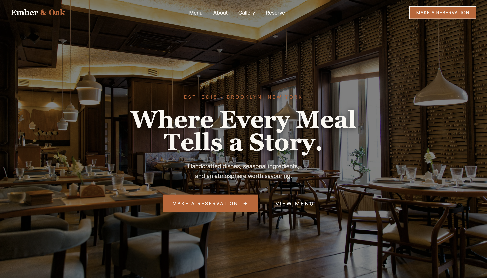
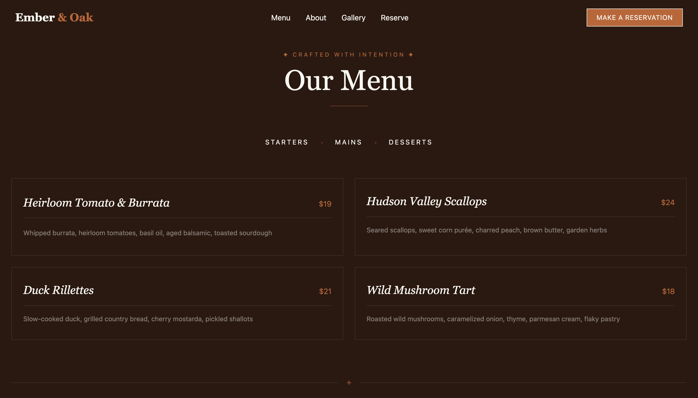
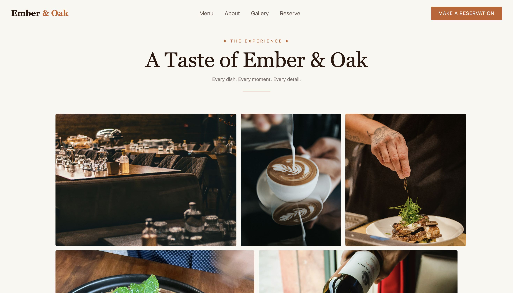
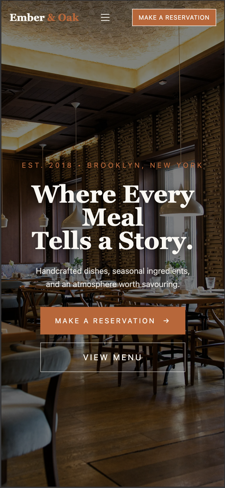

# Ember & Oak — Restaurant Website

Ember & Oak is a restaurant website I built to practice frontend development and create a more polished, real-world style project for my portfolio.

I wanted to give it a warm, premium feel with a simple layout, elegant typography, and food photography that fits the overall theme. I also worked on making the website responsive so it looks good on both desktop and mobile screens.

## Features

- Responsive navigation with a mobile hamburger menu
- Hero section with reservation and menu buttons
- Restaurant story and introduction section
- Menu section with starters, mains, and desserts
- Photo gallery with a separate mobile layout
- Customer testimonials
- Reservation form UI
- Footer with opening hours, navigation links, and social links
- Hover effects and responsive layouts
- Optimized images for faster loading

## Built With

- HTML5
- Tailwind CSS
- JavaScript

## What I Learned

While building this project, I got more practice with responsive layouts, Tailwind CSS utility classes, and JavaScript DOM manipulation.

I also worked on changing navbar colors based on the section in view, building a mobile navigation menu, adjusting layouts for different screen sizes, and optimizing images.

This project helped me understand how small layout and styling decisions can make a big difference to the overall look and usability of a website.

## Preview

### Hero Section

### Menu Section

### Gallery

### Mobile View

## Live Demo

https://ember-and-oak-kohl.vercel.app/

## Future Improvements

- Connect the reservation form to a backend
- Add functionality to the menu category filters
- Improve accessibility and continue refining performance

## Author

Maverick
